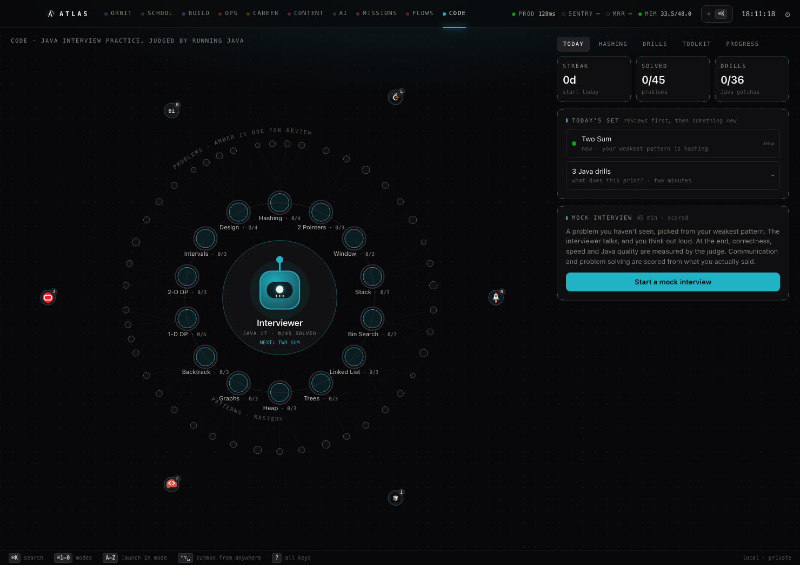
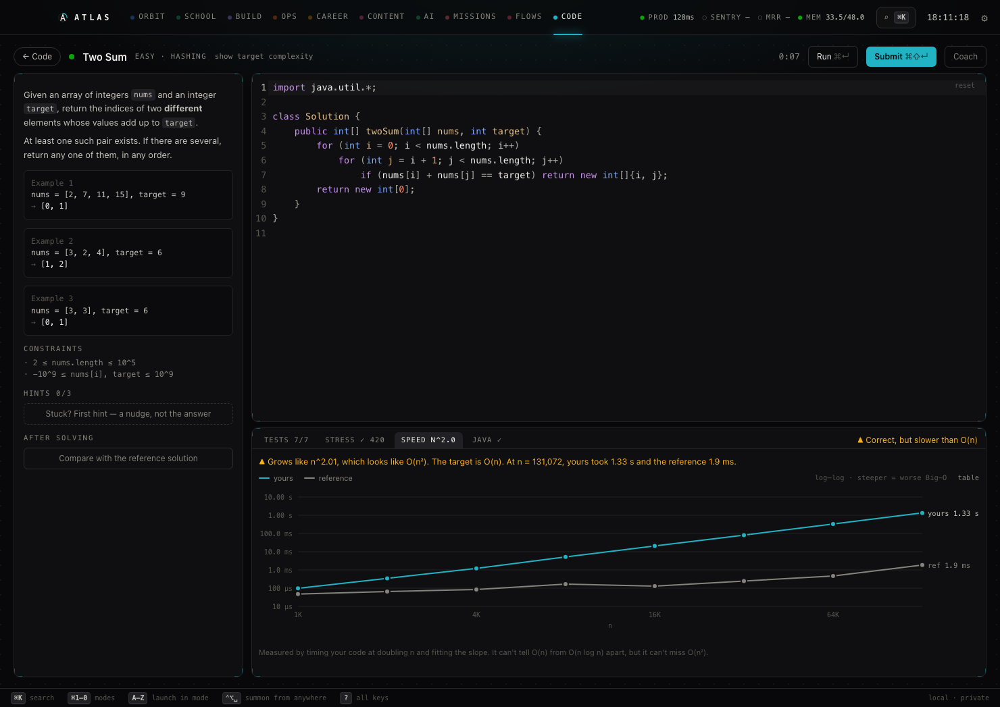

# Atlas

A local-first command center for students who build things. It's a native macOS app (Tauri, Rust, React), and
every agent runs on your own machine through [Ollama](https://ollama.com).

Atlas puts your classes, repos, production health, job search, content and interview practice in one place. Each
area is a concentric "world": an agent sits at the centre, its data sits on rings ordered by meaning, and its tools
sit on the rim.



## The rule it's built on: facts from code, judgment from the model

Small local models are cheap, private and fast. They're also confident about things they haven't checked. Atlas
never asks a model whether something is true when code can find out:

- **CODE judges Java by running it.** A model never decides whether your solution works or how fast it is.
- **Research findings must quote the page they cite**, and the quote is verified against the fetched text. On a
  real run this took verified findings from 0/20 to 15/20.
- **Drafted posts and resume bullets are checked in Rust** against your real commits, roadmap and resume. Each one
  has to cite the line it's built from, and ungrounded numbers or tech get flagged.
- **Today's schedule is computed, not model-written**, so the morning brief can't move your 8am class.

The model does what models are good at: interviewing you, coaching, planning and writing in your voice.

## Modes

| Keys | Mode | What it's for |
|---|---|---|
| ⌘1 | Orbit | Your projects as planets. Click into any folder: each one has its own agent that sees only that folder |
| ⌘2 | School | Today's classes, the week, course folders with tutor agents that teach rather than do the work |
| ⌘3 | Build | Every repo's roadmap progress and git activity |
| ⌘4 | Ops | Production health checks, Sentry and RevenueCat for your live product |
| ⌘5 | Career | Internship pipeline, a Handshake inbox agent that ranks opportunities for you, resume tailoring |
| ⌘6 | Content | Posts drafted from what you shipped, per identity (you vs. your brand) and per account |
| ⌘7 | AI | Local agents with live project context |
| ⌘8 | Missions | Research swarms with verified citations |
| ⌘9 | Flows | n8n workflows that act for you, behind an approval click |
| ⌘0 | Code | Java interview practice, judged by running Java |

Press **`?`** anywhere for every shortcut (or see [docs/CHEATSHEET.md](docs/CHEATSHEET.md)).

## CODE: interview practice that measures your Big-O



There are 45 problems across 14 patterns: hashing, two pointers, sliding window, stacks, binary search, linked
lists, trees, heaps, graphs, backtracking, 1-D and 2-D DP, intervals, and class design (LRU cache, trie,
union-find). Every submit goes through three stages:

1. **Tests.** 5–10 edge cases per problem (empty input, duplicates, int extremes, the answer at either end).
   Expected answers come from running a reference solution, not from hand-written values.
2. **Stress.** Hundreds of small random inputs compared against the reference, smallest first. If one breaks
   your code, you get the smallest failing input to trace by hand.
3. **Speed.** Your code and the reference are timed as n doubles, then a log-log slope is fitted. A brute-force
   Two Sum passes every test, then measures n^2.01: 1.33 s against 1.9 ms at n = 131k. The fit can't tell O(n)
   from O(n log n), but it can't miss O(n²).

Around the judge:

- **36 "what does this print?" drills** on the Java details interviews probe: the Integer cache at 127 vs 128,
  `==` on strings, overflow, `remove(int)` vs `remove(Object)`, overloading vs overriding. Every expected output
  was captured from a real JDK 17.
- **A Java linter** for interviewer red flags: `new Stack<>()`, `(lo + hi) / 2`, comparators written as `a - b`,
  boxed `==`, `String +=` in a loop.
- **Pattern guides** (signals, a template to know cold, pitfalls) and a Java toolkit.
- **Spaced repetition.** A clean solve comes back in 3 days, then about 2.5× longer each time. A hint, a peek at
  the solution or a too-slow solve brings it back tomorrow.
- **A coach and a 45-minute mock interviewer** on a local model. Each turn it gets the judge's facts and exactly
  one next hint. The mock ends in a scorecard: correctness, efficiency and Java quality are measured;
  communication and problem solving are scored by the model, and every score has to quote something you actually
  said, or the quote is thrown out.

Problems are authored to [src-tauri/code/AUTHORING.md](src-tauri/code/AUTHORING.md), and
`python3 src-tauri/code/validate.py` checks every problem against a real JDK. It confirms that:
- the reference passes its own tests and matches the written examples
- the starter compiles and fails
- the reference's measured speed matches the stated Big-O

## Requirements

- macOS (it uses Mail.app, the Keychain and `open`)
- [Rust](https://rustup.rs), Node 20+, pnpm and [ripgrep](https://github.com/BurntSushi/ripgrep) (`brew install ripgrep`, used by folder agents)
- [Ollama](https://ollama.com) with `qwen3:14b` and `qwen3:8b` (`ollama pull qwen3:14b qwen3:8b`)
- For CODE: a JDK 17+ (`brew install openjdk@17`)
- Optional: Docker, for local [SearXNG](https://github.com/searxng/searxng) search (Missions) and
  [n8n](https://n8n.io) (Flows)

## Run

```sh
pnpm install
pnpm tauri dev      # hot-reloading dev window
pnpm tauri build    # → src-tauri/target/release/bundle/macos/Atlas.app

cd src-tauri && cargo test                                       # unit tests
cd src-tauri && cargo test --release judge_live -- --ignored     # live Java judge test
python3 src-tauri/code/validate.py                               # every problem and drill vs a real JDK
```

To render the UI in a browser with your own data (for design work and screenshots):

```sh
ATLAS_FIXTURE=$PWD/mock/fixture.json cargo test --manifest-path src-tauri/Cargo.toml dump_fixture -- --ignored
pnpm mock           # → http://localhost:1430/?mode=code
```

## Make it yours

On first run, Atlas writes `~/.config/atlas/config.json` from
[src-tauri/src/defaults.rs](src-tauri/src/defaults.rs). Edit that file, not the defaults, and Atlas re-reads it
on every refresh:

- **`profile`**: your name, a one-line description, school, term and priorities. Every agent prompt is written
  from it.
- **`projects`**: repos to track. Each takes a roadmap file (Markdown checkboxes become progress bars) and
  optional Sentry project slugs.
- **`launchers`**: the tools on each world's rim, each with a letter key.
- **`agents`**: model, system prompt, and which projects and files each agent sees.
- **`courses_file`**: your class schedule as `CODE | Title | Mon,Wed | 08:00 | 08:50 | Room` lines.
- **`career_profile`**: what the inbox agent ranks job opportunities against.

API keys (Sentry, RevenueCat, n8n) go in through Settings (⌘,) and live in the macOS Keychain.

## Architecture

```
React (webview)  ── invoke / Channel ──►  Rust core  ──►  git · Ollama · JDK · Sentry · RevenueCat · n8n
  no network, no secrets                      │
                                              ├── macOS Keychain (API keys)
                                              └── 127.0.0.1:47321 local API (token) ◄── n8n workflows
```

Decisions worth knowing:

- **No sidecar server.** Every integration lives in Tauri's Rust core: one process, no second runtime to ship.
- **Secrets never reach JavaScript.** The webview's CSP only allows IPC to Rust. Keys are written to the Keychain
  through write-only commands, and the UI can ask whether a key exists but never read one back.
- **Launch by id, never by command.** The UI can only say "open launcher `github`". Rust looks up the target and
  calls `/usr/bin/open` with argv, no shell.
- **Folder agents are sandboxed.** Their read-only tools are confined to the folder in Rust: paths are
  canonicalised, and `..`, absolute paths and symlinks out are rejected.
- **Retrieval is done for the model.** Rust ranks files by IDF-weighted keyword matches and hands over the
  densest 200-line window. On a ground-truth question this took an 8B folder agent from 0/7 to 7/7, ahead of a
  14B agent that had the whole repo.
- **Nothing outward happens without a click.** Workflows that post, send or apply pause in an n8n Wait node until
  you approve (or edit) in Atlas. Resume URLs are pinned to the local n8n.

## Security notes

- The judge compiles and runs Java on your machine: your own code, plus the reference solutions in
  `src-tauri/code/problems`. Read the `Ref.java` and `Cases.java` in any problem you didn't write before running it.
- The local API binds to 127.0.0.1 only and requires the bearer token in `~/.config/atlas/api-token` (mode 600).

## Contributing

Problems, drills and fixes are welcome. See [CONTRIBUTING.md](CONTRIBUTING.md).

## License

[MIT](LICENSE)
